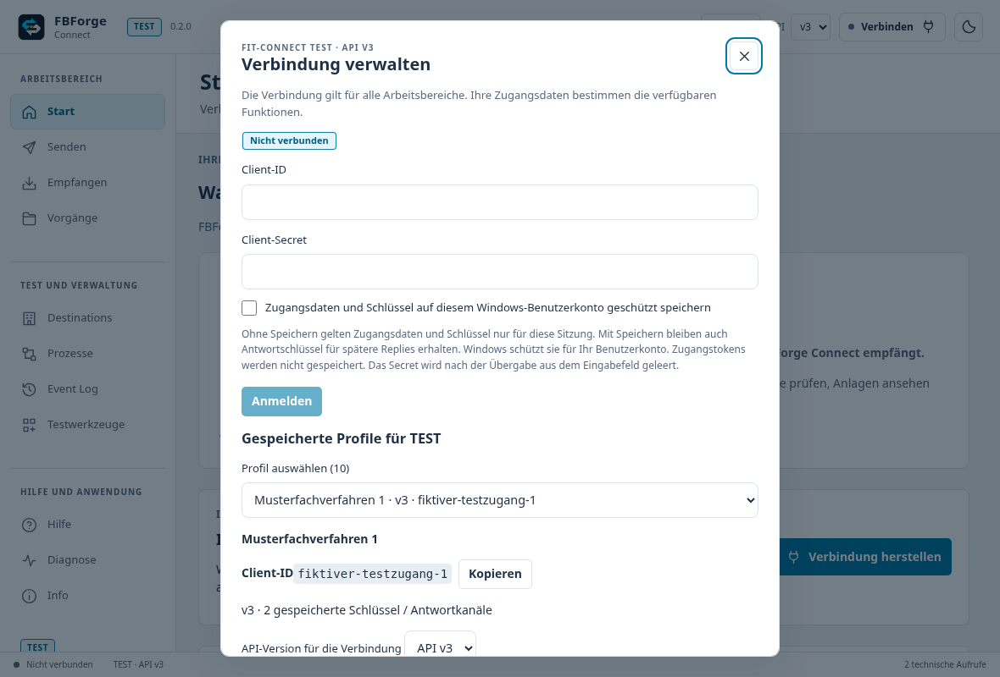
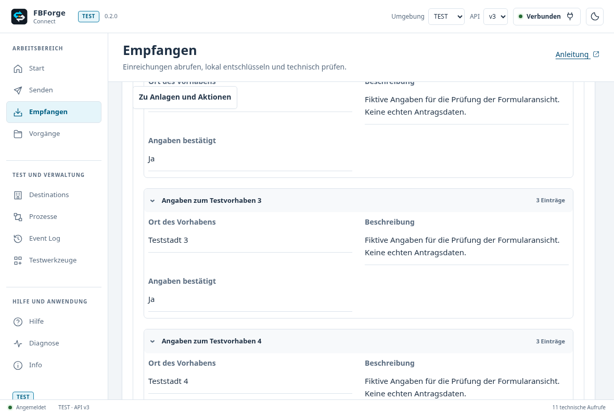
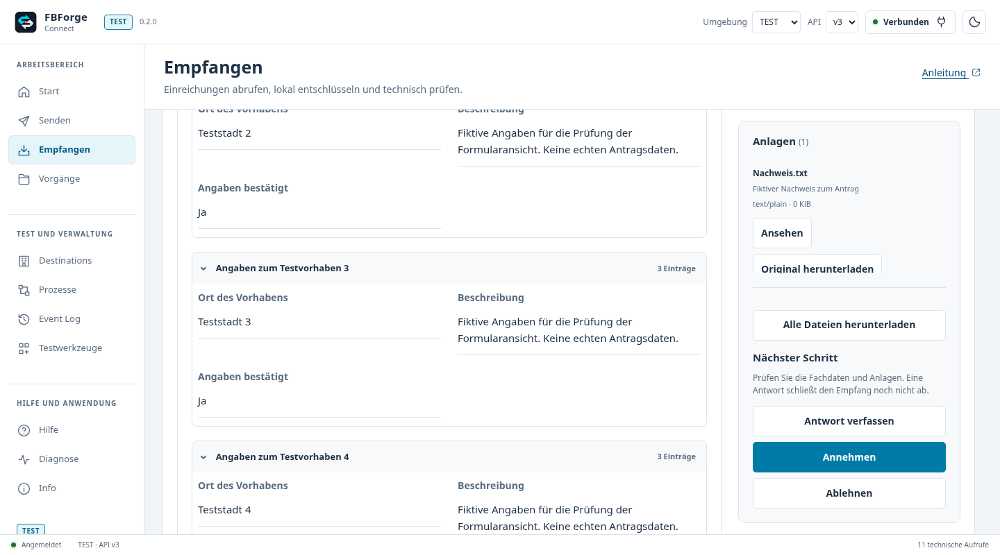

# Design-Review: FBForge Connect

## Nachprüfung und Korrekturen für 0.3.0

Stand: 31. Oktober 2026, Branch `release/0.3.0`. Die Nachprüfung des Ausgangsstands
`439963c` ergab 14 Befunde. Die folgende Zuordnung hält ihre Umsetzung und die
zugehörigen Regressionstests fest.

| Befund | Umsetzung | Regression |
| --- | --- | --- |
| U01: Neustart verwirft Fortschritt | Bestätigung, Abbruch und Ergebnisexport. Auch ein anderer Ablauf ersetzt Ergebnisse erst nach Bestätigung. | `integration-comfort.spec.js` |
| U02: Speichern war nur Dateiexport | Bearbeitete Pakete direkt in der gemeinsamen geschützten Sammlung speichern und nach erneutem Öffnen weiterverwenden. Export separat benannt. | `review-findings.spec.js`, bestehende native Sammlungstests |
| U03: Falscher Hinweis beim Versandschritt | Eigene nächste Aktion für alle sechs Schrittarten. | `integration-comfort.spec.js`, `review-findings.spec.js` |
| U04: Verwaltung vor laufender Aufgabe | Aktueller Schritt zuerst, Verwaltung darunter aufklappbar. Fokus folgt dem Schritt. | `review-findings.spec.js` |
| U05: Abstände bei Auswahl und Aktionen | Beschriftung über dem Feld, gemeinsame Aktionsgruppen. | `review-findings.spec.js` |
| U06: Langer Schema-Assistent | Kompakte Feldgruppen, Exporte vor aufklappbarer Verwendungsanleitung. | `review-findings.spec.js`, `channel-authoring.spec.js` |
| U07: Scanner-Verwaltung gleich gewichtet | Signaturupdate direkt am Status, Einrichtung und Offline-Import unter „Komponente verwalten“. | `local-scanner.spec.js`, `review-findings.spec.js` |
| U08: Verschachtelter großer Profileditor | Schmaler Ersatzdialog, nach Abbruch oder Speichern zurück zur vorherigen Auswahl. | `profile-maintenance.spec.js` |
| U09: Wiederholte Scan-Hinweise und lange Antwortansicht | Doppelten allgemeinen Hinweis entfernen, Ergebnisse je Anlage erhalten. Format vor dem Inhalt, Dateiübernahme optional aufklappbar. | `receive-warning-presentation.test.js`, `review-findings.spec.js`, `scanner-feedback.spec.js` |
| U10: Technische Ereignispfade | Gründe zuerst, kurze Problem- und Anlagenbezeichnungen. Originalpfade und verlustfreie Werte bleiben verfügbar. | `event-details.test.js`, `acceptance-polish.spec.js` |
| U11: Einzelbearbeitung wie Sammeländerung | Direkte Felder mit Vergleich zum geladenen Stand. Nur Änderungen vorbereiten. Sammeländerungen behalten Feldauswahl. | `destination-edit-changes.test.js`, `review-findings.spec.js`, `destination-manager.spec.js` |
| U12: Ladeaktion nach erfolgtem Laden | Kompakter Status und gezielt „Formularbeschriftungen neu laden“. | `scanner-feedback.spec.js` |
| U13: Anmeldung im kleinen Fenster | Kompakter Text und erreichbare Aktionsleiste. | `review-findings.spec.js` |
| U14: Singular | Ein Testfall, mehrere Testfälle. | `review-findings.spec.js` |

Validierung: 227 Oberflächenfälle und 310 JavaScript-/Skripttests bestanden.
Zusätzlich Produktionspaket mit Größenbudget und ausgeführter Navigation geprüft.
Acht neue Detailaufnahmen in Hell, Dunkel und im kleinen Fenster ergaben keine
JavaScript-Fehler, externen Abrufe oder automatisch erkannten WCAG-Verstöße.
Die Website-Prüfung umfasst 24 Python- und 11 Kontakttests sowie 138
Browser-Prüfungen. App- und Website-Anleitung verwenden dieselben 48 Bildquellen.

Die Tests bedienen die tatsächlichen Vue-Komponenten in Chromium mit synthetischen
Daten an der nativen Grenze. Sie ersetzen keinen Abnahmetest unter Windows mit
echten FIT-Connect-Zugängen, nativen Dateidialogen und installiertem Scanner.
Die aktuelle bebilderte Anleitung wird aus `docs/guide/` exportiert. Die frühere
Bewertung unten bleibt als historische Ausgangslage für 0.2.0 erhalten.

## Live-Prüfung für 0.3.0 am 31. Oktober 2026

Status: automatisierte Live-Abnahme in TEST bestanden. Die
[Windows-Validierung 41226794001](https://github.com/FBForge/fbforge-connect/actions/runs/41226794001)
prüfte den Produktstand `fc050678d084b0a259b902e445cca6502fa940f7`.
Der [vollständige Live-Lauf 41233271432](https://github.com/FBForge/fbforge-connect/actions/runs/41233271432)
verwendete genau dessen Installer und den Abnahmetreiber `0bb2336`.
Einzelne frühere Läufe scheiterten an den unten dokumentierten Produktfehlern oder
an der nativen Dialog-Automation. Erst der vollständige abschließende Lauf ist grün.

Die installierte Windows-App wurde über ihre echte WebView2-Oberfläche und native
Dialoge mit den hinterlegten TEST-Zugängen bedient. Die native Grenze wurde nicht
ersetzt. Alle Inhalte waren fiktiv. Änderungen betrafen eine eigens angelegte
TEST-Destination. Schlüssel und Profilsicherungen blieben im temporären
Windows-Benutzerbereich und wurden nicht als Artefakte hochgeladen.

Zwei zusätzliche Produktfehler wurden gefunden und mit Regressionen korrigiert:

| Befund | Korrektur | Nachweis |
| --- | --- | --- |
| L01: Geladener Scanner wird beim Öffnen als ausgeschaltet angezeigt | Der gemeinsame Scanner-Monitor behält die Zustandsführung. Das Öffnen überschreibt seine geladene Konfiguration nicht. | Drei zuvor fehlgeschlagene Oberflächenfälle für lokalen Scanner, ICAP und Profilwechsel. Danach 27 gezielte Fälle grün. Commit `b1b29d3`. |
| L02: Gespeicherte Antwortschemas bleiben als ungewiss angezeigt | Die Bestätigung vergleicht unterstützte Schemakennungen und Leistungen unabhängig von der normalisierten Reihenfolge. Tatsächliche Abweichungen und Wiederholungssperren bleiben erhalten. | Regressionen für Reihenfolge, mehrere Leistungen, fehlende, ersetzte und doppelte Kennungen. 18 gezielte Verwaltungstests grün. Echte API-Rücklesung und anschließend die Schema-Verwendung in der installierten App bestanden. Commit `fc05067`. |

Die Scanner-Aufnahmen [Hell](images/scanner-state-light.png) und
[Dunkel](images/scanner-state-dark.png) zeigen die tatsächliche Vue-Komponente mit
fiktiven Daten. Sie sind keine Aufnahmen der Sitzung mit echten Zugangsdaten.

Im vollständigen Live-Lauf bestanden:

- Native JSON- und XML-Nachrichten mit Anlagen und Antworten über v2/v3, auch
  fragmentierter XML-Versand mit 5 MiB, signierte Event Logs, Annahme und Ablehnung,
  Schlüsselrotation sowie Beschränkung auf die Absender-Destination über beide APIs.
- Installierte Oberfläche: Anmeldung, geschützte Profile, API-Wechsel, Versand,
  Entschlüsselung, PDF-Vorschau, Antworten, Empfangsbestätigungen und Vorgänge.
  Schemafehler bleiben lesbar. Sammelannahme verarbeitet nur gültige Nachrichten.
  Manuelle Abweichungsannahme und begründete Ablehnung wurden ausdrücklich bestätigt.
- Native Datei- und Ordnerdialoge mit Downloadordner als Vorgabe, sichtbarer
  Abbruchmeldung und bytegenauen Einzel- und Gesamtexporten. Der Testtreiber wartet
  auf gespeicherte Dateien und bestätigt die Dateinameneingabe vor dem Speichern.
- Profilbearbeitung mit Fokus-Rückgabe, geschützte Sicherung, Überschreibschutz,
  Löschen und Wiederherstellen ausschließlich des eigenen Testprofils.
- Echte Prozessnachrichten, signiertes Eingangsalter, Altersfilter, älteste zuerst,
  Favoriten sowie alle sechs Ablauf-Schritte anhand tatsächlicher Nachrichten und
  Anlagen. Abbruch erhält Ergebnisse, Export und bewusstes Zurücksetzen funktionieren.
- Vollständiger App-Neustart mit geschützten Testpaketen, Ablaufdefinitionen,
  gespeicherten Vorgängen und profilbezogener Speicherpräferenz. Anschließendes
  ausdrückliches Löschen der Testpaket- und Ablaufsammlung funktionierte.
- Hell, Dunkel, Systemdarstellung, Fokus-Rückgabe und Navigation aller Arbeitsbereiche.
- Offline eingerichteter lokaler ClamAV bei echten Nachrichten. Kontrollierte harmlose
  ICAP-Funde über v2/v3 sperren genau die betroffene Anlage. Eine ausdrücklich bestätigte
  Annahme enthält das passende signierte Anlagenproblem. Es wurde kein EICAR an
  FIT-Connect übertragen.
- Echter FreshClam-Signaturupdate mit weiter bedienbarer Versandseite und Rückkehr
  zum bereiten Scanner. Die Aktualisierung war beim Zurückkehren bereits abgeschlossen.
  Die separate [Windows-Probe 41234366430](https://github.com/FBForge/fbforge-connect/actions/runs/41234366430)
  mit Treiber `8c461fe` brach zusätzlich eine echte laufende Aktualisierung gezielt ab.
  Abbruchmeldung, wieder bedienbare Aktion und weiterhin bereiter Scanner mit gültigem
  Signaturbestand bestanden. Diese Probe benötigt keine TEST-Zugänge oder Schreibzugriffe.
- Eigene Antwortschemas: Schema, Beispiel und bearbeitbarer Entwurf exportiert,
  Entwurf wieder importiert, Kennung nur am eigenen Zustellpunkt registriert und
  echte Antwort damit gesendet, geprüft, empfangen und bestätigt.
- Echte GitHub-Updatesuche. Der noch fehlende Release-Feed wird als
  `update_feed_unavailable` angezeigt und bietet keine ungeprüfte Installation an.

Die temporäre Destination `edf3e725-6614-4dd0-a594-b60e654bc506` wurde nach dem Lauf
deaktiviert. FIT-Connect erlaubt ihre Löschung frühestens am
30. November 2026 um 19:24:18 UTC. Die Deaktivierung und Löschfristen früherer
Versuchsläufe stehen ebenfalls in deren Aktionsprotokollen.

Zusätzlich bestanden lokal 233 Oberflächenfälle und 317 Skripttests einschließlich
PowerShell ohne übersprungene Fälle. Die
[reguläre CI 41233271440](https://github.com/FBForge/fbforge-connect/actions/runs/41233271440)
bestand mit 276 Java- und 61 Windows-Kernfällen. Unter Ubuntu überspringt sie drei
PowerShell-Fälle und einen Browserfall, die lokal zusätzlich bestanden.
Diese Zahlen beschreiben ausgeführte Tests, keine vollständige Testabdeckung.

Offene Freigabepunkte: STAGE/PROD wurden mit diesen TEST-Zugängen nicht abgenommen.
Die öffentliche 0.3-Hilfe liefert vor ihrer Veröffentlichung noch 404. Die
Installation eines neueren signierten Releases ist separat zu prüfen, sobald ein
entsprechendes Updatepaket veröffentlicht ist. Das Nachladen der Scanner-Komponente
bei der erstmaligen Online-Einrichtung ist durch diesen Offline-Start ebenfalls
nicht als Live-Nachweis abgedeckt. Die Tests ersetzen keine manuelle Usability- oder
formale Sicherheitszertifizierung.

## Historischer Review für 0.2.0

Stand: 28. Oktober 2026 · Quelle: `369d6f5` · Arbeitsbranch: `design/review`.

## Umsetzung für 0.2.0

Alle sechs Befunde wurden umgesetzt. Die ursprüngliche Bewertung und ihre Bilder
unten dokumentieren den Ausgangsstand; die folgenden Aufnahmen zeigen den neuen Stand.

| Befund | Änderung | Neue Evidenz |
| --- | --- | --- |
| 1: Profile | Profilauswahl und Verbinden zuerst; neue Zugangsdaten separat aufklappbar. Auch bei 420 × 500 ohne Scrollen verbindbar. | [Profile](images/after-profiles.png) |
| 2: Standardfenster | Zweispaltig ab 52 rem, auch mit kompletter Sidebar bei 1180 × 800. | [Leseansicht](images/after-reader-default.png) |
| 3: Schmale Ansicht | Empfangsaktionen stehen im Dokument vor langen Anlagenlisten; Sprunglink überlagert den Formularanfang nicht mehr. | Gemeinsamer Regressionstest mit 19 Anlagen |
| 4: Benennung | „Was möchten Sie tun?“, „Einreichung senden“ und „Einreichungen abrufen“; PROD-Bestätigungen bleiben erhalten. | [PROD](images/after-prod.png) |
| 5: Darstellung | System / Hell / Dunkel; Systemänderungen wirken während der Sitzung, manuelle Auswahl bleibt erhalten. | [Darstellung](images/after-appearance.png) |
| 6: Fachdaten | Schema und Erzeugungsaktionen zusammengefasst, kürzere Hinweise, XML-Technik unter dem gemeinsamen Aufklappbereich. | [Fachdaten](images/after-data.png) |

Zusätzlich wurden die drei Umgebungskennzeichen vereinheitlicht. Die Farbwerte
stammen aus dem öffentlichen SSP-Stylesheet vom 28. Oktober 2026:

- TEST: `--fitko-blau-3`, `#0092cb`.
- STAGE/REFZ: `--fitko-gelb`, `#fcbf49`.
- PROD: `--fitko-gruen`, `#90be6d`.

Quelle: <https://portal.auth-prod.fit-connect.fitko.net/static/v2/assets/index.css>;
die TEST-Instanz enthält dieselbe Zuordnung. Die Umgebungsfarbe bezeichnet die
Umgebung, nicht den Erfolg oder die Unbedenklichkeit einer Aktion. Dunkle Schrift
sichert die Lesbarkeit; produktive Warnungen und native Bestätigungen bleiben separat.
[TEST](images/after-test.png), [STAGE](images/after-stage.png), [PROD](images/after-prod.png).

Auch die Dropdowns wurden komponentenübergreifend abgeglichen: Beschriftungen in
Formularen stehen mit 8 px Abstand über dem Feld; kurze API-Auswahlen haben 12 px
horizontalen Abstand und brechen bei Bedarf um. Die kompakte Toolbar bleibt getrennt.
Der native Auswahlmechanismus, Tastaturbedienung und Systemfarben bleiben erhalten.

Fünf zusätzliche Browser-Regressionsfälle prüfen direkte Profilverbindung,
Darstellungspräferenzen, alle SSP-Umgebungen einschließlich Hell/Dunkel und Titel
sowie den vollständigen Empfang mit langem Formular und 19 Anlagen. Die aktuellen
Layout-Messwerte stehen unter [after-measurements.json](after-measurements.json).

## Ursprüngliche Zusammenfassung

**Bewertung: Gut, mit zwei wichtigen Verbesserungen für den Alltag.**
Die Anwendung soll einen Mitarbeiter sicher durch Versand, Empfang und Prüfung von
FIT-Connect-Nachrichten führen. Ihre Stärke ist eine ruhige, sachliche Arbeitsoberfläche:
Navigation links, Inhalte in der Mitte, Anlagen und nächste Schritte daneben.
Diese Struktur sollte erhalten bleiben. Ein vollständiges Redesign ist nicht nötig.

Zuerst sollten gespeicherte Profile direkt erreichbar werden und Anlagen samt Aktionen
auch bei der voreingestellten Fenstergröße neben dem Formular bleiben. Weitere Punkte
betreffen schmale Ansichten, die Benennung produktiver Aufgaben und das Systemdesign.

Die ursprüngliche Bewertung wurde zuerst auf `design/review` gesichert. Ihre
anschließende Umsetzung gehört zum neuen 0.2.0-Kandidaten und benötigt dessen eigene Abnahme.

## Methode und Grenzen

- Apple-Design-Skill mit den gelesenen HIG-Kapiteln Accessibility, Layout, Typography,
  Color, Designing for macOS, Sidebars, Modality, Entering Data, Dark Mode und Writing
  sowie den Begleittexten zur frameworkübergreifenden Übertragung und Codeprüfung.
- Die allgemeinen Prinzipien wurden auf die bestehende **Windows-/Tauri-/Vue-Anwendung**
  übertragen. macOS-Menüleisten, SwiftUI-APIs, SF Symbols und Liquid Glass sind keine
  Anforderungen an diese Windows-Version. SwiftUI Expert ist für den vorhandenen
  Vue-Code nicht der passende Codeprüfer.
- Alle hier verwendeten Bilder wurden in diesem Review neu aufgenommen und visuell
  geprüft. Die unveränderten Komponenten laufen in lokalem Chromium mit fiktiven
  Antworten an der nativen Schnittstelle. Es wurden keine echten Zugangsdaten oder
  Antragsdaten verwendet und keine FIT-Connect-Schreibaktionen ausgeführt.
- Aufnahmen bei 1440 × 1000 sowie zusätzliche Prüfungen bei 1180 × 800
  (konfigurierter Standard), 640 × 700 und 420 × 500 (konfiguriertes Minimum).
  Empfang wurde zusätzlich in der **vollständigen Anwendung mit Sidebar** geprüft;
  reine Komponentenaufnahmen bilden deren verfügbaren Platz nicht vollständig ab.
- Zwölf zusätzliche Zustände mit Axe und WCAG-2.2-A/AA-Regeln: **keine gemeldeten
  Verstöße**. Geprüft wurden unter anderem Hell/Dunkel, kleines Fenster, Dialog,
  langer Formularinhalt und erzwungene Systemfarben. Das ist keine vollständige
  WCAG-, BITV-, VoiceOver- oder NVDA-Zertifizierung.
- Browser-Schriftwiedergabe, Fensterrahmen und native Dialoge können von einem echten
  Windows-Zielgerät abweichen. Dieser Review enthält keinen neuen Screenreader-Test
  und keine Beobachtung unerfahrener Anwender. Frühere Release-Tests werden hier
  nicht als neue Design-Evidenz ausgegeben.
- Messwerte und Zuordnung der Aufnahmen: [evidence.json](evidence.json).

## Geprüfte Schritte

Die Bilder zeigen jeweils den tatsächlichen aufgenommenen Zustand, einschließlich
der aktuellen Scrollposition. Kopfzeilen von eigenständigen Test-Fixtures werden
nicht als Gestaltung des eigentlichen Programmrahmens bewertet.

| Schritt | Ansicht und Aufgabe | Zustand | Evidenz |
| --- | --- | --- | --- |
| 1 | Aufgabe auf der Startseite wählen | Gut; Benennung für PROD verbessern | [Start](images/01-start.png) |
| 2 | Aus zehn gespeicherten Profilen verbinden | Hohe Reibung: Hauptaktion unterhalb des Dialogausschnitts | [Profile](images/02-profile.png) |
| 3 | Versand adressieren | Gut; viel Platz für Einleitung vor den Eingaben | [Adressierung](images/03-send.png) |
| 4 | Schema und Beispieldaten lesen | Gut; technische Angaben noch stärker nachordnen | [Fachdaten](images/04-data.png) |
| 5 | Versand ausdrücklich bestätigen | Gut: Kontext und Abbruch erkennbar | [Bestätigung](images/05-confirmation.png) |
| 6 | Lange Einreichung im Standardfenster lesen | Hohe Reibung: Anlagen/Aktionen unter dem Formular | [1180 Pixel](images/06-reader-default.png) |
| 7 | Lange Einreichung im breiten Fenster lesen | Gut: Anlagen/Aktionen bleiben beim Scrollen rechts | [1440 Pixel](images/07-reader-wide.png) |
| 8 | Anlagen/Aktionen im schmalen Fenster aufsuchen | Verbesserungsbedarf bei langen Anlagenlisten | [640 Pixel](images/08-reader-compact.png) |
| 9 | Nicht verfügbares Schema behandeln | Gut: Ursache, nächste Aktion und technische Details getrennt | [Schemafehler](images/09-schema-error.png) |
| 10 | Ergebnis einer Sammelverarbeitung beurteilen | Gut: angenommene und manuell offene Nachrichten getrennt | [Sammelverarbeitung](images/10-batch.png) |
| 11 | Wechsel zu PROD bestätigen | Gut: Folgen, Warnung und Abbruch erkennbar | [PROD-Wechsel](images/11-prod.png) |
| 12 | Dunkles Design und Systemwechsel nutzen | Darstellung gut; laufender Systemwechsel wird nicht übernommen | [Dunkles Design](images/12-dark.png) |
| 13 | Kleinstes unterstütztes Fenster verwenden | Bedienbar, kein horizontaler Überlauf; Navigation wird zu Symbolen | [420 × 500](images/13-minimum.png) |
| 14 | Lokale Vorgänge und Klärungsbedarf finden | Gut: Verlauf und ausstehende Klärung verständlich | [Vorgänge](images/14-cases.png) |
| 15 | Technische Diagnose nachvollziehen | Gut: Aktion, Kontext und Ergebnis getrennt | [Diagnose](images/15-diagnostics.png) |

## Verbesserungen nach Priorität

### 1. Hoch: Gespeicherte Profile vor der manuellen Anmeldung anbieten

**Beobachtung:** Bei 1180 × 800 beginnt „Mit Profil verbinden“ bei **y = 802,5 px**;
der Dialog endet schon bei ungefähr 776 px. Zehn Profile sind bereits kompakt
auswählbar, aber das leere Formular für neue Zugangsdaten steht weiterhin davor.
Der häufige Wiedereinstieg verlangt dadurch unnötiges Scrollen.

**Grundlage:** `layout.md › Visual hierarchy`: „Order content by relative importance.“
`entering-data.md › Best practices`: „When possible, offer choices instead of requiring text entry.“
Quellen: [Layout](https://developer.apple.com/design/human-interface-guidelines/layout#Visual-hierarchy),
[Dateneingabe](https://developer.apple.com/design/human-interface-guidelines/entering-data#Best-practices).

**Vorschlag:** Sobald Profile existieren, Profilauswahl, API-Version und „Mit Profil
verbinden“ zuerst zeigen. Neue Zugangsdaten unter „Anderen Zugang verwenden“
aufklappbar anbieten. Ohne gespeicherte Profile bleibt die manuelle Anmeldung offen.
Client-ID, Schlüsselstatus und die Schutzinformationen bleiben erreichbar.

**Umsetzungspunkt:** `frontend/src/app/ConnectionDialog.vue:98` und `:169`;
die vorhandene Komponente `SavedProfiles.vue` umordnen, keine neue Anmeldelogik.

**Abnahme:** Ein und zehn Profile, 1180 × 800 und 420 × 500, Tastatur und Fokus;
Profilverbindung ohne vorheriges Scrollen erreichbar. Secrets weiterhin nicht vorausfüllen.

### 2. Hoch: Zweispaltige Leseansicht schon im Standardfenster erhalten

**Beobachtung:** Bei einer Fensterbreite von 1180 px bleiben innerhalb der tatsächlichen
Anwendung **868 px** für die Leseansicht. Die Zweispaltenregel beginnt erst bei
**56 rem = 896 px**. Deshalb ist die Seitenleiste dort `position: static` und liegt
unter dem langen Formular. Im fiktiven langen Beispiel liegt „Annehmen“ zunächst
bei y = 4318 px. Bei 1440 px Fensterbreite ist die Seitenleiste dagegen wie beabsichtigt
`sticky`, und „Annehmen“ liegt bei y = 637 px. Der Sprunglink ist ein vorhandener
Ausweg, ersetzt aber nicht die gewünschte gemeinsame Übersicht.

**Grundlage:** `layout.md › Adaptability`: „Design a layout that adapts gracefully and consistently.“
`designing-for-macos.md › Best practices` empfiehlt weniger Verschachtelung bei
komfortabler Informationsdichte. Die Übertragung auf Windows ist die Bewertung
dieses Reviews, keine macOS-Pflicht.
Quelle: [Anpassbare Layouts](https://developer.apple.com/design/human-interface-guidelines/layout#Adaptability).

**Vorschlag:** Den Container-Breakpoint beispielsweise auf **52 rem** prüfen und die
rechte Spalte im Zwischenbereich auf **280 px** begrenzen. Erst bei tatsächlich zu
wenig Inhaltbreite stapeln. Auch bei gestapelter Darstellung die nächsten Aktionen
direkt erreichbar lassen. Den Fokus- und Scrollversatz des Sprunglinks mitprüfen;
er liegt auf der Aufnahme teilweise über dem Formularanfang.

**Umsetzungspunkt:** `frontend/src/styles/application-case-reading.css:220` und
`frontend/src/DocumentLayout.vue:28`. Gemeinsames Layout für Empfang und Vorgänge behalten.

**Abnahme:** In der vollständigen Anwendung bei 1180 × 800 mit langem Formular und
1/19 Anlagen prüfen. Aktionen nach 850 px Scrollen sichtbar; keine abgeschnittenen
Werte, keine Überlagerung der Überschrift; vergrößerte Texte weiterhin stapelbar.

### 3. Mittel: In schmalen Ansichten Aktionen nicht hinter langen Anlagenlisten verstecken

**Beobachtung:** Bei 640 × 700 führt „Zu Anlagen und Aktionen“ zum Beginn der
19 Anlagen. „Annehmen“, „Ablehnen“ und „Antwort verfassen“ stehen danach und
sind im gezeigten Ausschnitt nicht sichtbar. Im breiten Fenster ist die getrennt
scrollbare Anlagenliste bereits die bessere Lösung.

**Grundlage:** `layout.md › Visual hierarchy`: „Order content by relative importance.“
Die vorgeschlagene Anordnung ist eine konkrete Abwägung für den Arbeitsablauf.

**Vorschlag:** Eigener Sprung „Zu Empfangsaktionen“ oder Aktionen vor der Anlagenliste;
lange Anlagenlisten zunächst als „19 Anlagen anzeigen“ zusammenfassen. Ein kompakter
Aktionsbereich darf den Formularinhalt und Tastaturfokus nicht verdecken. Keine neue
Bestätigung beim bloßen Navigieren hinzufügen.

**Umsetzungspunkt:** `frontend/src/DocumentLayout.vue` und `frontend/src/ReceivePanel.vue:291`.

### 4. Mittel: Aufgaben auch für den produktiven Einsatz benennen

**Beobachtung:** Die Startseite fragt „Was möchten Sie testen?“ und bietet ausschließlich
„Fachverfahren testen“ / „Onlinedienst testen“. Der Versand beginnt mit „In drei
Schritten zum Testversand“. Seit der Erweiterung auf STAGE/PROD ist die Anwendung
auch für den echten Abruf und die Bearbeitung vorgesehen. Die Umgebung ist sichtbar,
aber der dauernde Testbegriff erklärt diese Nutzung nicht ausreichend.

**Grundlage:** `writing.md › Best practices`: „Consider each screen’s purpose“ und
„Give clear guidance and use consistent language throughout processes with multiple steps.“
Quelle: [Texte](https://developer.apple.com/design/human-interface-guidelines/writing#Best-practices).

**Vorschlag:** „Was möchten Sie tun?“, „Einreichung senden“ und „Einreichungen abrufen“
als Hauptaufgaben. Testzwecke im erklärenden Text ergänzen. Testpakete und fiktive
Beispieldaten ausdrücklich weiterhin als Testfunktionen kennzeichnen. PROD-Warnungen
und zusätzliche native Bestätigungen vollständig erhalten.

**Umsetzungspunkt:** `frontend/src/StartWorkspace.vue:9` und die Einleitung in
`frontend/src/SubmissionSender.vue`; Navigationstitel damit abgleichen.

### 5. Mittel: Systemdarstellung während der Sitzung nachvollziehen

**Beobachtung:** Ohne gespeicherte Designpräferenz bleibt die Anwendung nach einem
Wechsel der Browser-Systempräferenz zu Dunkel auf `data-theme="light"`, obwohl
`matchMedia` bereits Dunkel meldet. Erst nach neuem Laden folgt sie der Systemeinstellung.
Beide tatsächlich dargestellten Designs sind für sich gut lesbar.

**Grundlage:** `dark-mode.md › Best practices`: „Ensure that your app looks good in both
appearance modes“; die Beschreibung nennt automatische Wechsel während laufender Apps.
Quelle: [Dunkles Design](https://developer.apple.com/design/human-interface-guidelines/dark-mode#Best-practices).

**Vorschlag:** Eine nachvollziehbare Auswahl „System / Hell / Dunkel“ und einen
`matchMedia`-Change-Listener verwenden, solange „System“ gilt. Manuelle Auswahl
respektieren und eine Rückkehr zum System ermöglichen. Apples Empfehlung gegen einen
zusätzlichen App-Schalter wird hier nicht mechanisch auf Windows übertragen.

**Umsetzungspunkt:** `frontend/src/app/useTheme.ts:12` und der vorhandene Design-Schalter.

### 6. Niedrig: Fachdaten vor technischen Erläuterungen stärker hervorheben

**Beobachtung:** Die Schemaauswahl steht inzwischen richtig vor der Erzeugung. Danach
folgen jedoch mehrere gleich gewichtete Erläuterungen und technische Aufklappbereiche,
bevor das eigentliche Formular beginnt. Die Oberfläche hat bereits passende
Aufklappmechanismen; zusätzliche Karten würden die Hierarchie nicht verbessern.

**Grundlage:** `layout.md › Visual hierarchy`: „Use progressive disclosure to make layouts
cleaner and easier to interact with.“ `typography.md › Conveying hierarchy` empfiehlt
Gewicht, Größe und Farbe passend zur Bedeutung einzusetzen.
Quelle: [Typografische Hierarchie](https://developer.apple.com/design/human-interface-guidelines/typography#Conveying-hierarchy).

**Vorschlag:** Schema und Erzeugungsaktion kompakt zusammenhalten, Hinweise auf zwei
kurze Sätze begrenzen und technische Struktur/Namespaces unter einem gemeinsamen
Aufklappbereich lassen. Fachdaten mit 14–15 px und klaren Gruppenüberschriften
beibehalten. **Ein entbehrliches Element:** eine wiederholte technische Einleitung
entfernen, statt eine weitere Karte oder Animation hinzuzufügen. Das ist gestalterisches
Urteil dieses Reviews, kein Sicherheitsumbau.

**Umsetzungspunkt:** `frontend/src/send/DataStep.vue:33` und die bestehende Formularansicht.

## Was erhalten bleiben sollte

- Die drei nachvollziehbaren Versandabschnitte und der ausdrücklich bestätigte Versand.
- Kontextbezogene Schemafreigabe mit Erklärung, Abbruch und lokalem Ausweg.
- Klare Fehlerüberschrift, konkrete nächste Aktion und separat aufklappbare Fehlercodes.
- Sichtbare PROD-Warnung mit Folgen und sicherem Abbruch; keine dekorative Animation
  für produktive Schreibaktionen.
- Die gemeinsame, in breiten Fenstern mitlaufende Anlagen-/Aktionsspalte.
- Fachdaten mit Schema-Bezeichnungen statt ausschließlich technischen Feldnamen.
- Zusammenhängende Vorgänge und erkennbare Fälle mit Klärungsbedarf.
- Einheitliche SVG-Symbole, sichtbare Textlabels und zurückhaltender Akzent.
- Systemfarben bei hohem Kontrast und reduzierte Bewegung. Kein Bedarf an einem
  Glas-/Blur-Effekt im Datenbereich.

### Gemessene Farbbeispiele

Berechnet aus den tatsächlichen CSS-Tokens, nicht aus geschätzten Screenshotfarben.
Die Beispiele sind keine vollständige Prüfung aller Farben, Hintergründe oder Zustände.

| Text / Hintergrund | Kontrast |
| --- | --- |
| `#1e3044` auf `#ffffff` | 13,45:1 |
| `#596b7f` auf `#ffffff` | 5,48:1 |
| `#596b7f` auf `#f7f9fb` | 5,19:1 |
| Weiß auf Hauptaktion `#007ba8` | 4,77:1 |
| `#e7eef7` auf `#192638` | 13,06:1 |
| `#acbdd0` auf `#192638` | 7,96:1 |

Grundlage: `accessibility.md › Vision`, Mindestkontrast für normalen Text 4,5:1.
[Apple: Accessibility](https://developer.apple.com/design/human-interface-guidelines/accessibility#Vision).

## Empfohlene Reihenfolge

1. Profilauswahl und Standardfenster-Leseansicht verbessern, ohne die geprüfte
   Anmelde-, Schlüssel- oder Annahmelogik zu ändern.
2. Schmale Aktionsansicht und Systemdarstellung korrigieren.
3. Aufgabenbezeichnungen und Informationshierarchie vereinfachen.
4. Nur die betroffenen Browserprüfungen wiederholen; vor Übernahme neuer Programmänderungen
   die erforderliche Windows-Abnahme des neuen Quellstands durchführen.

Ein vollständiger Umbau, neue Animationen und eine Migration zu SwiftUI sind aus
diesem Review nicht begründet. Die Umsetzung wird als Teil von 0.2.0 erneut abgenommen; Main bleibt bis zur Übernahme unverändert.
